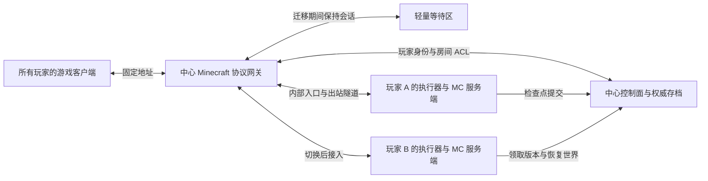

# 中心网关、玩家计算与换主机研究

## 最新范围确认（2026-10-10）

产品已限定朋友间互信，不做反作弊或恶意计算者验证；优先完成正常停服、最终上传、状态恢复的朴素交接。下面不断线迁移及较强权威验证内容属于历史研究/可选后续，不是第一版验收条件。云端控制面管理任务与已提交状态，计算节点实际运行 Minecraft。以 [产品愿景](产品愿景.md) 为准。

研究日期：2026-10-10。本文区分当前已实现的链路、上游提供的能力、以及尚待验证的设计。没有购买的服务器也可以先在本机模拟中心、A 执行器、B 执行器；公网质量、真实玩家客户端和跨物理电脑仍要单独实测。

## 结论

建议把中心升级为「控制面 + Minecraft 协议网关」，重型世界模拟运行在所选计算节点上，可以是被授权玩家电脑，也可以是中心服务器或其他常驻服务器。服务器是否参与与优先级由管理员配置；补充需求见 [计算节点与网络接入](计算节点与网络接入-扩展需求.md)。用户的游戏客户端始终连接中心的同一个地址；中心决定这个账号可以进入哪个逻辑房间，以及房间当前由哪个执行器计算。

第一阶段目标是切换计算者时保留玩家到中心的连接、无需重新输入地址或手动重连，期间允许进入等待区或显示迁移提示。世界 tick 不间断、人物和原世界画面完全无感的迁移是更深的一层，不能由固定地址或 TCP 转发自动获得。

当前 NomadCraft 只实现了原生 TCP 的透传和 world ZIP 恢复：玩家登录、加密和游戏会话属于后端 Java 服务端，关闭旧任务会关闭转发通道。已有真实两执行器验证证明存档恢复，并未证明玩家在线会话连续。要达成新目标，中心必须持有并管理客户端协议会话。

## 推荐结构

- **中心控制面**：社区身份与 Minecraft UUID 绑定、房间 ACL、托管资格、逻辑实例和固定发布版本、管理员命令、当前 epoch、候选与迁移流程、权威检查点引用。
- **中心协议网关**：固定 Minecraft 入口、正版身份认证、玩家会话与连接、房间分流、后端切换、等待区、状态提示；网关可与面板部署同一台机器，运行独立进程。
- **计算执行器**：可以在玩家电脑或服务器运行同一套托管生命周期；服务器模式不需要游戏客户端。
- **玩家电脑执行器**：由启动器启动独立服务端进程，运行区块、实体、红石和模组计算，保存并同步世界。游戏客户端可以与服务端在同一台电脑上运行，两者仍是不同进程。
- **出站通道**：电脑主动连接中心的 HTTPS/WSS。网关连接的是中心本机的私有后端入口，私有入口再接到执行器；外部玩家不能直接连接这些入口。这样沿用现有 Rust agent 的出站隧道，不要求玩家路由器开放端口。

玩家电脑上的 Java 仍只监听回环地址。协议网关前端与内部后端连接分别管理；不要把代理终止协议误当成传输层换一条 TCP 线路。

## 可复用的软件与取舍

| 方案 | 已有能力 | 与本项目关系 | 限制 |
| --- | --- | --- | --- |
| 现有 Rust/Node 透传 | 出站隧道、原生 TCP、中心租约 | 保留为网关与执行器之间的内部链路 | 无法自行接管登录和在线会话 |
| Velocity | 代理端账号认证、后端服务器连接切换、事件 API | 推荐作为第一轮协议网关，写 NomadCraft 控制插件 | 不是世界迁移引擎；不同加载器和模组要实测 |
| PicoLimbo | 精简登录与 KeepAlive、等待服、代理转发支持 | 推荐先验证独立轻量等待区，避免中心常驻完整 MC 世界 | 要验证匹配的协议版本、注册表及模组客户端切换 |
| LimboAPI | Velocity 内的虚拟服务器，支持登录/游戏中进入 limbo | 可作为内嵌等待区的备选 | 与代理内部协议实现相关，要验证组合版本 |
| MultiPaper | 单世界多节点，Master 协调区块计算与数据 | 借鉴数据所有权和同步机制，作为 Paper 路线的研究样本 | 上游是 1.20.1 Purpur 分支并标注 public beta；不是通用 Forge/NeoForge 运行底座 |
| Mammoth/WorldQL | 跨进程世界分片/同步的历史实现 | 参考历史问题与边界，不作为当前新依赖 | Mammoth 仓库归档且明确不再维护 |

这些结论来自维护者文档与官方仓库 [1–8]。本轮没有声称已经把 Velocity 或 Limbo 接入项目。

## 一个地址如何对应多个房间

建议社区只有一个公开网关入口，默认 Minecraft 端口或 DNS SRV 隐藏端口。不要继续给用户公布执行器的临时 TCP 端口。

选择房间有两种互补方式：普通客户端进入中心等待区后选择自己获准进入的房间；NomadCraft 客户端 选择云端存档时把短期加入意图提交给中心。中心在 Minecraft 登录成功后根据认证 UUID 与当前 ACL 解析加入意图，代理插件读取这个结果，再选择房间后端。

加入意图应绑定社区、Minecraft UUID、逻辑房间、固定发布版、有效期和随机 nonce，并且一次性消费。社区账号与 Minecraft 身份必须有可信绑定流程；不能接受玩家自己声明「我是管理员的 UUID」。协议插件不接收普通玩家任意指定后台地址或 epoch。

每个房间绑定客户端协议与内容环境。固定一个地址不意味着同一个正在运行的游戏客户端可以任意切换到不同 MC 版本或不兼容整合包。跨内容环境需要先由启动器准备对应客户端，再进入同一个社区入口。

## 正版身份与后台配置

Velocity 可以在代理端启用 online-mode 认证，后台按其转发规范接收账号信息。官方文档要求受支持的后台关闭自己的 online-mode，并启用 modern forwarding；这不是把公网社区改为不验证正版，而是把认证职责移到可信中心。[1,2]

纯 Mojang vanilla 服务端缺少玩家信息转发支持，官方兼容性文档建议 Fabric + FabricProxy-Lite 保持原版客户端兼容，或采用对应的其它转发适配。正式选型必须验证客户端 UUID、playerdata 文件和白名单一致，禁止因为离线 UUID 变化丢失背包。[2,3]

后台只允许通过受授权隧道到达。Forwarding secret 用来认证转发来源，不是授予托管电脑社区管理权的钥匙；社区会话、管理 API 密钥、中心策略签名私钥都不下发给执行器。对中心而言，电脑上的后台及其插件消息仍是不可信输入。

## 计划内换主机流程

下面是待实现的状态机，不是已经完成的迁移功能：

1. **RUNNING(A, epoch N)**：网关把房间玩家接到 A，中心记录唯一计算权。
2. **PREPARING(B)**：确认 B 的账号授权、意愿、设备在线、Java/环境和资源；预下载 jar、模组及最近检查点。B 只能做准备，不能获得第二份可写计算权。
3. **DRAINING(A)**：停止新玩家进入旧后端；把现有玩家切到中心等待区，让旧后台完成玩家离开事件及 playerdata 保存。等待区不允许产生新的世界操作。
4. **COMMITTING**：旧后台完成世界、玩家数据、受支持模组/插件持久化并正常停服，提交当前 epoch 的最终检查点。中心确认提交后才释放旧 epoch。
5. **STARTING(B, epoch N+1)**：B 应用最后差量，恢复已确认检查点并启动同一个固定发布版；验证 UUID、世界与运行策略，再报告就绪。
6. **SWITCHING**：代理使用后端连接 API 把同一批在线玩家从等待区接到 B；用户无需编辑地址或退出到服务器列表。
7. **RUNNING(B)**：中心公布新计算者，保持逻辑房间、ACL、管理员与会话归属不变。

Velocity 的 Player.createConnectionRequest 和 KickedFromServerEvent 重定向机制提供后端连接/回退的基础，[4,5] 但保存确认、唯一计算权和世界恢复由我们实现。上游 BackendPlaySessionHandler 对后台 KeepAlive 的处理是继续转发，并在非正常断开时根据 failover 配置选择回退或断开玩家。[12] 因此单纯在代理里「等旧后台恢复」并不等于可靠保活，必须显式接入等待区/独立会话处理。

玩家下线保存、背包、位置、经验、效果、乘骑实体、维度和模组持久化必须在这个顺序里实测。仅复制当前 world ZIP 无法保证所有模组内存或 world/ 之外的插件数据库已保存。保持连接的第一版允许重新加载世界/区块，不能宣传成完整 JVM 内存热迁移。

## 突然断线与迁移失败

旧主机失联时，代理把玩家送入等待区；中心等待旧计算权过期并隔离旧 epoch，然后从最近成功的检查点恢复。等待区继续维持协议心跳，且显示「正在恢复房间」。PicoLimbo 的核心就是精简登录/KeepAlive，LimboAPI 也提供游戏中进入虚拟服的接口。[6,7]

失联前没有成功同步的数据无法凭空恢复；现有周期检查点保证的是恢复点，不是零回滚。B 启动失败时保留等待区，尝试其他合格候选或终止恢复。必须有等待超时和明确失败提示，不能承诺所有故障永久不掉线。

中心网关本身崩溃、玩家到中心的网络断开或客户端崩溃时，普通 TCP 会话仍会断开。本阶段「换计算者不断线」的前提是中心与玩家连接存活；网关自身的跨进程容灾另做研究。

## 如果要求原世界里完全无感

需要额外解决世界实时状态、玩家会话、实体 ID、协议状态和模组注册表的同步。可继续研究：

- 保留画面的中心迁移桥：短暂停止接受世界输入，网关维持心跳和界面，新后台就绪后重新同步必要状态。要避免把排队的挖方块/交易等旧操作重复应用到新 epoch。
- 常驻热备：持续同步世界和关键运行态；需要可恢复/可重放的状态接口，不能让两套普通服务端独立 tick 同一世界后再合并。
- 分布式模拟：借鉴 MultiPaper 的区块所有权与 Master 协调。它涉及服务端内核改造，性能、模组兼容和故障一致性应单独立项。[8]

Minecraft 1.20.5 加入的 transfer 是客户端连接目标服务端的流程，不是把正在运行的后台内存迁移；它也不能覆盖当前 1.20.1 验证基线。[9]

据此，首选先验证「固定入口 + 协议代理 + 等待区 + 有序恢复」，再根据实际切换体验决定是否投入完全保留原世界画面的协议桥。

## 逻辑主机与权限边界

以下是拟议的中心权威规则：

| 权限/状态 | 决策者 | 执行器能否自己改中心状态 |
| --- | --- | --- |
| 社区管理员、实例发布、托管授权 | 中心账号与 ACL | 不能 |
| Minecraft 身份、房间准入、封禁 | 中心协议网关 | 不能把自报 UUID 当作身份 |
| 当前可写 epoch、检查点引用 | 中心租约和存档提交 API | 旧 epoch 不能提交 |
| 管理命令、OP 的权威配置 | 中心鉴权后签发具体操作 | 本地文件修改不回写为中心授权 |
| 模拟世界、模组计算结果 | 玩家电脑后台 | 仍可被拥有系统控制权的人改动 |

中心插件消息通道必须检查消息来源和处理结果。PaperMC 官方提醒：错误转发插件消息会让客户端冒充代理；后台消息也可请求玩家转服。[10] 本项目应默认关闭无约束的 BungeeCord 控制消息，使用专用控制通道，并对房间、玩家、epoch、动作白名单与重放逐项检查。

同样，不能简单删掉代理收到的所有管理员聊天命令来宣称权限已经安全。现代签名聊天/命令需要版本适配，Velocity 官方也专门记录了取消或修改签名消息的限制。[11] 社区管理操作优先走中心 API，游戏里的受支持管理命令由配套模块调用中心鉴权。

**基于本项目威胁模型的推论：**中心可以阻止托管者修改中心账号权限、转移房间所有权或提交旧任务，但一个恶意托管者仍能把本机模拟改成给自己物品、改变伤害，甚至发送伪造的世界结果。HTTPS、哈希、部署签名和转发身份验证都不会自动证明计算诚实。若用户要求这部分也严格可信，需要对关键状态建立中心可验证的规则、可信计算者/备份复核，或者研究受硬件约束的可信执行；这还没有实现，且任意模组的验证成本不能假定很低。

因此首轮托管计算应由授权成员承担，风险清楚记录；逻辑管理权持续留在中心。

## 中心成本与选主机输入

中心不 tick 正式游戏世界，但会消耗代理协议处理、加密、转发带宽、存档 I/O 和等待区资源。不要把 PicoLimbo 的上游基准当作我们的实际资源预算；拿到服务器后测真实玩家数量、区块流量和模组包。

路径延迟可粗略按 RTT(玩家,中心) + RTT(中心,计算者) 估算，最终以实际游戏往返为准。选计算者时不能只看 CPU 或本人游戏 ping，还要看执行器到中心的上传、时延/抖动、内存余量、Java/模组兼容、掉线历史和快照同步状况。

托管意愿已实现为用户账号字段 hostingWillingness：high/medium/low/none，默认 medium。普通用户进入「个人设置」或账号弹窗即可修改，使用自助 GET/PUT /api/auth/hosting-preference；只操作当前会话账号，拒绝目标 UUID 与额外权限字段，并使用既有 Storage 持久化。登录账号信息也返回这个字段。

未来候选过滤首先满足托管授权、存档访问、设备在线与资源下限；none 不进入自动候选。高/中/低影响候选排序，但不立即定义数值权重，不让高意愿但不合适的机器获胜。考虑当前主机稳定性、最短任期和切换成本，避免高/中排序波动导致频繁迁移。切成 none 不直接强杀正在托管的房间，未来由调度器安排有序交接；当前手动托管逻辑不变。

本轮没有启用自动选主机，更没有后台偷偷启动服务端。账号偏好为后续算法提供输入。

## 不等服务器到货的下一轮实验

固定 MC 1.20.1 客户端环境，先验证 Fabric 原版体验 + 适配转发模块；同时保留现有纯 vanilla 的存档闭环作为回归。中心本机运行 Velocity、PicoLimbo 和控制插件；A/B 是不同执行器目录。

实验要求：真实客户端第一次进入中心后，记录并持续保持同一客户端到网关的连接；A → 等待区 → B 迁移过程中不回服务器列表、不手动重连；背包/位置/UUID 正确；旧 epoch 禁止提交；主动换主机和突然断网分别验证。故意篡改转服通道、管理请求和目标房间，确认中心拒绝。用包捕获及客户端日志证明会话保留，不能仅用新后端状态 ping 宣称不掉线。

这一实验仍是待做项。先通过原版客户端，再逐包测试 Fabric/Forge/NeoForge 的握手和切换；加载器名字相同也不代表任意整合包兼容。[3]

## 第一手资料

1. [Velocity 配置与中心认证](https://docs.papermc.io/velocity/configuration/)
2. [玩家信息转发](https://docs.papermc.io/velocity/player-information-forwarding/)
3. [服务端与模组兼容性](https://docs.papermc.io/velocity/server-compatibility/)
4. [Player 后端连接 API](https://jd.papermc.io/velocity/3.4.0/com/velocitypowered/api/proxy/Player.html)
5. [KickedFromServerEvent 回退 API](https://jd.papermc.io/velocity/3.4.0/com/velocitypowered/api/event/player/KickedFromServerEvent.html)
6. [PicoLimbo 官方仓库](https://github.com/Quozul/PicoLimbo)
7. [LimboAPI 官方仓库](https://github.com/Elytrium/LimboAPI)
8. [MultiPaper 官方仓库](https://github.com/MultiPaper/MultiPaper)；[同步配置说明](https://github.com/MultiPaper/MultiPaper/blob/main/MULTIPAPER_YAML.md)；[已归档 Mammoth](https://github.com/WorldQL/mammoth)
9. [Mojang 1.20.5 发布说明](https://www.minecraft.net/sv-se/article/minecraft-java-edition-1-20-5)
10. [Velocity 插件消息及来源检查](https://docs.papermc.io/velocity/dev/plugin-messaging/)
11. [签名聊天/命令限制](https://docs.papermc.io/velocity/faq/)

12. [Velocity 后端 KeepAlive 与断线处理源码](https://github.com/PaperMC/Velocity/blob/dev/3.0.0/proxy/src/main/java/com/velocitypowered/proxy/connection/backend/BackendPlaySessionHandler.java)
