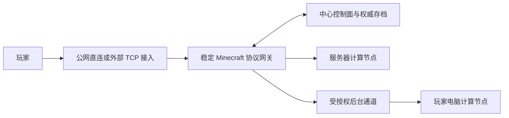

# 计算节点与网络接入扩展（2026-10-10）

本轮把用户新增的两项要求纳入产品设计：中心服务器可以自己运行 Minecraft，也可以按优先级参加调度；玩家入口支持公网 IPv4/IPv6、端口映射、外部穿透和其他转发网络。本文件保留需求与验收边界；第一轮实现已接入配对节点、房间策略、独立 TCP 入口和网络自检，见 [实现记录](计算节点与网络自检-实现.md)。外部工具自动部署与不断线网关仍待开发。

## 两个独立维度

「谁计算」与「如何连进来」必须独立。中心控制面、Minecraft 协议网关、计算执行器、外部接入节点可以在同一台服务器，也可以拆开部署。换接入方式不改变房间或托管授权；换计算者不要求玩家修改入口。

| 计算策略 | 行为 | 与服务器的关系 |
| --- | --- | --- |
| 固定计算节点 | 房间只由指定节点运行 | 可以固定中心服务器，得到传统服务端运行方式 |
| 自动调度 | 从授权、在线、资源合格的候选中选计算者 | 服务器和玩家电脑共同参加，管理员配置节点优先级 |
| 服务器兜底 | 正常优先合格玩家，缺少玩家候选时考虑指定服务器 | 服务器也必须有资源与执行授权，不能无限兜底 |
| 不参与计算 | 节点只承担管理/入口等职责 | 低配中心仍可只运行控制面和网关 |

固定节点是硬约束。不能把旧调度器的 preferred 加分当作固定模式；固定节点离线时默认显示不可用，只有显式配置的故障接管策略才能改选。

中心服务器作为计算者应运行同一执行器生命周期：领取独占 epoch、部署固定版本、恢复世界、运行服务端、提交检查点和正常停服。它不用运行游戏客户端或 WPF 启动器。本轮 panel-node 命令已作为常驻独立进程自动上报资源并领取任务；目前完整游戏闭环验证在 Windows 本机，不能据此声称 Linux 服务器服务化部署已完成。

旧 Rust scheduler 已有 anchor、priority 和资源评分，仍与面板运行时分开。本轮面板调度器已接入当前用户权限、节点资源预算和托管意愿。服务器节点有独立启用状态和管理员优先级，不继承某个管理员账号的玩家托管意愿。玩家节点继续参考该用户的高/中/低/无，none 排除自动候选；用户意愿不是算力节点的管理授权。

本轮调度前检查节点上报的可用内存、CPU 和当前任务负载，并通过预留内存为同机控制面/网关保留预算；磁盘与实际网络质量尚未纳入评分。资源上报是调度参考，不能证明不可信计算者未篡改。优先级不会覆盖资源下限。同一台服务器允许多个不同存档任务，但每个存档仍只有一个可写任务。房间策略、节点资源配额、空闲时继续运行/休眠是分别配置的行为。

## 传统运行与网关运行

固定服务器时可支持两个入口布局：

1. **传统直连**：玩家直接连这个服务器的 MC 进程或其外部端口映射；原生认证与联机由服务端处理，云端继续管理环境、权限配置和存档。此布局不承诺计算迁移时保留在线连接。
2. **统一网关**：玩家始终连稳定协议网关，网关连接同机 MC 后台；需要迁移到玩家电脑时，复用等待区和后台切换设计。协议代理支持后台地址配置，[1] 但实际迁移逻辑仍待开发。

想保留「换计算者不回服务器列表」能力时，应选择第二种布局。世界实际运行位置变化不意味着必须改变公网入口。

## 三层网络接入

将网络划为：

- **公开入口**：玩家输入的域名/IP 与端口，可以由中心自身或外部接入服务提供。
- **稳定网关**：持有玩家协议会话与房间分流，不能随计算者退出。网关可以与中心同机，也可运行在另一个稳定节点。
- **内部后端通道**：网关到当前计算者，选择本机回环、可信内网/VPN、受授权出站隧道等。

统一网关示例：

这里「直接」表示入口直接暴露中心网关，不是绕过网关直连可变计算者。纯 TCP 转发接在网关前面，仍由网关处理 Minecraft 会话。接入节点自己崩溃或隧道断开时，现有 TCP 会话可能断开，换域名解析或备用 IP 只恢复新连接，不等于已经实现连接级容灾。

## 要支持的接入类别

| 接入类别 | 建议接法 | 客户端要求与边界 |
| --- | --- | --- |
| 自有公网 IPv4 | 外部域名/IP:端口 → 中心网关 | 按实际端口配置入站网络；不强制绑定某个端口号 |
| 自有公网 IPv6 | IPv6/域名:端口 → 中心网关 | 用结构化 host/port 保存，格式化字面地址时加方括号；应验证客户端到入口的 IPv6 路径 |
| 双栈 | 两类监听和公开地址进入同一网关 | 必须分别验证 IPv4、IPv6，不把单个 IPv6 绑定当作双栈已验收 |
| 路由器/NAT/平台端口映射 | 外网地址:公开端口 → 网关监听地址:监听端口 | 本机有私网 IPv4 不代表公网可达；没有可控外网映射时换外部隧道 |
| frp/通用 TCP 穿透 | 外部 TCP 入口 → 穿透连接 → 网关本地端口 | 原生 MC 客户端连对方分配的地址；控制端口和玩家端口分开 [2] |
| TCP 四层代理 | 外部代理 → 网关 | NGINX stream 支持 TCP/UDP 转发和 IPv6 监听；不使用普通 HTTP proxy_pass 当游戏代理 [3,4] |
| VPN/虚拟组网 | 网关和后台通过私网地址通信 | 适合内部节点互通；若玩家直接使用这个私网，必须具备相应网络接入，不能宣传成公网免辅助软件 |
| 需客户端辅助的隧道 | 辅助程序本地端口 → 服务商 → 网关 | 应单独标记客户端依赖，未来启动器按用户配置启动对应助手 |
| 其他接入服务 | 只要能提供经过实测的原始 TCP 映射，连接到稳定网关 | 品牌通过适配器或用户已有配置接入；不承诺任意网站穿透都能传游戏协议 |

现有自研 HTTPS/WSS 出站隧道继续用于内部后端通道。不能直接把其 URL 填进普通 MC 的服务器地址；原生客户端需要标准游戏 TCP 入口。

## 穿透软件的端口到底是什么

以 frp 为例，官方示例明确区分三个端口 [2]：

- frps.bindPort / frpc.serverPort：穿透两端建立连接的控制入口，例子使用 7000。
- localPort：网关在本地接收原生 TCP 的端口，我们可以配置为 25565。
- remotePort：外部接入机给玩家连接的公开 TCP 端口，可以配置为 30065。

示例拓扑：玩家连接 edge.example.com:30065 → 外部 frps → frpc 已建立的隧道 → 127.0.0.1:25565 的网关。7000 是穿透两端使用的连接端口，玩家不应把它当作 MC 入口。

以上域名和端口是说明用途，不是已经部署的服务或真实凭据；不应把某个穿透商的控制端口硬编码成玩家地址。

## 网页接入和游戏接入分开

社区网址/HTTPS API、WebSocket 执行器通道、原生游戏 TCP 是不同服务，可以使用不同接入方案和端口。某种穿透能访问网页，并不证明它能让原生 Minecraft 直接连接。

Cloudflare 官方文档说明其公开主机名 TCP 路由由客户端 cloudflared access tcp 接入。[5] 因此可以记录为需辅助程序的适配方式，不把普通 HTTP Tunnel 当作免客户端的 MC 入口。

Tailscale 的私有 Serve 与公网 Funnel 也要分别配置。Funnel 文档有允许端口、TLS/域名等限制；CLI 文档同时提供 raw TCP forwarder 选项。[6,7] 接入时需验证具体组合，不能仅凭有一个 TCP 开关就标注原生 MC 免辅助可用。

第一轮可声明并实测 TCP 游戏入口；有 UDP 等扩展服务时必须单独填写并验证协议映射，不能把现有 TCP WebSocket 通道写成所有协议都支持。

## 配置模型与后续扩展

本轮已实现节点类别、身份、启用状态、优先级、内存预算、实例范围；每个存档可配置手动、固定、自动或服务器兜底策略，以及独立的监听端点和公开端点。后续扩展包括显式故障接管、空闲策略、工具托管和异地健康探测。完整设计字段包括：

- 节点：类别 server/player、执行身份、在线状态、资源预算、是否参与、管理员优先级、允许房间范围。
- 房间：固定节点/自动/兜底策略，候选限制，显式故障接管策略，闲置运行策略。
- 接入配置：本地 bindHost/bindPort，公开 advertisedHost/advertisedPort，TCP/可选其他协议，是否需要客户端助手，稳定网关位置，内部后台通道。
- 外部适配：generic TCP / frp / private overlay / client-assisted 等类型；已有程序接入与程序托管分开。先允许填写已存在的映射，后做安装、更新、启动与凭据管理。
- 健康检查：从外部实际 Minecraft 状态握手、长连接稳定性、地址族、延迟和当前发布版兼容。网页接口 200 或隧道控制端连上不代表玩家已经能进游戏。

PROXY protocol 是可选能力，不能把普通客户端任意发来的源地址头当作真实来源。只有入口与网关两边都配置匹配且限定可信入口时才能启用；相关网关设置和 stream 支持见 [1,3]。

## 当前交付与待开发

已实现服务器/玩家节点配对与常驻执行器、固定/自动/兜底策略、资源和授权过滤、管理员优先级、独立监听/公开端口、IPv4/IPv6 地址族、已有 TCP 映射接入、frpc 配置导出、中心及房间网络自检。已有房间默认保持手动模式。

本轮本机真实闭环通过：固定服务器自动领取任务并运行 Minecraft；公开端口与本地监听端口不同的 TCP 映射可查询状态和登录；正常停服后改由玩家节点自动领取、恢复存档，原公开地址仍可连接。IPv4、IPv6 回环和同一双栈监听已通过真实 TCP 测试。

当前中转仍承载原始 TCP 数据，停止任务会关闭在线连接。固定入口可复用，保留玩家协议会话的迁移网关尚未实现。第三方穿透工具的安装、登录、进程管理，多面板分布式调度、真实公网和 Linux 服务部署验证也仍待开发。

| 板块 | 当前状态 | 下一步 |
| --- | --- | --- |
| 服务器作为固定计算者 | 配对、常驻执行器、固定策略和真实 Java 闭环已验证 | Linux 服务部署与真实服务器验证 |
| 服务器参与调度或兜底 | 面板已接入权限、意愿、预算、容量和优先级；固定/兜底边界有测试 | 多台物理节点、故障恢复和网络质量评分 |
| 多种公网/穿透接入 | 独立端点、地址族、已有 TCP 映射和 frpc 示例已交付；本机映射和双栈通过 | 异地公网、真实 frps 和工具托管 |
| 原生入口与辅助网络区分 | 配置记录并显示客户端依赖；原生 Minecraft 状态探测已实现 | 具体外部工具组合验证 |
| 网络自检 | 管理员可检查中心网络与房间入口；中心侧成功不视为公网证明 | 异地探针与持续监测 |

## 验收记录与后续验证

本机隔离面板、两个常驻节点与外部 TCP 映射入口的报告见 [真实游戏验证](proofs/compute-network-2026-10-10.json)。固定约束、授权、优先级、容量与兜底策略由面板测试覆盖；浏览器实际操作配对、房间策略、入口配置和自检，记录见 [网页验证](proofs/compute-network-ui-2026-10-10.json)。

拿到服务器后，补做公网 IPv4/IPv6、防火墙、异地原生客户端、真实穿透服务和长期运行验证。不断线迁移须完成协议网关后另行验收；这轮没有宣称完成。

## 第一手资料

1. [Velocity 配置：监听地址、后台地址与 PROXY protocol](https://docs.papermc.io/velocity/configuration/)
2. [frp 官方 TCP 端口映射示例](https://gofrp.org/en/docs/examples/ssh/)；[TCP/UDP 代理](https://gofrp.org/en/docs/features/tcp-udp/)
3. [NGINX stream 监听与地址族](https://nginx.org/en/docs/stream/ngx_stream_core_module.html)
4. [NGINX stream TCP/UDP 转发](https://nginx.org/en/docs/stream/ngx_stream_proxy_module.html)
5. [Cloudflare Tunnel 路由与客户端 TCP 接入](https://developers.cloudflare.com/tunnel/concepts/routing/)
6. [Tailscale Funnel 的限制](https://tailscale.com/docs/features/tailscale-funnel)
7. [Tailscale Funnel TCP CLI](https://tailscale.com/docs/reference/tailscale-cli/funnel)
